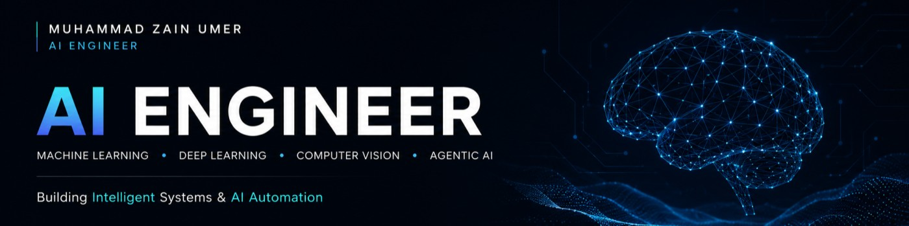

  

# 🚀 Hi there, I'm Muhammad Zain Umer! 

*A passionate software engineering student focused on building logic-driven applications, intelligent multi-agent systems and real-world computer vision solutions.*

 
 

---

### 👨‍💻 About Me

- 🎓 Currently in my **7th semester of BS Computer Science** and actively serving as Class Representative.
- 👁️ **Specialized in AI & Computer Vision:** Experienced in building surveillance pipelines (YOLOv8, OpenCV, PyTorch, ByteTrack).
- 🤖 **Agentic AI & Web Scraping:** Building complex, multi-agent workflows using **CrewAI**, **LangChain** and **n8n** to automate.
- 🌐 **Web & Extensions:** Developing responsive web apps and browser extensions (HTML, CSS, JS, Streamlit).
- 🧠 **Philosophy:** I believe in building strong foundational logic through manual coding and requirement-based learning.

---

### 🛠️ Tech Stack & Tools

  
**Languages**  

**AI, Machine Learning & Vision**  

**Frameworks & Tools**  

---

### 🚀 Highlighted Projects

| Project | Description | Tech Stack |
| :--- | :--- | :--- |
| **VisionGuard AI** | Intelligent surveillance software featuring intrusion zones, region of interest tracking and performance logging. | `OpenCV`, `PyTorch`, `YOLOv8`, `ByteTrack` |
| **PROMPTVAULT** | A Google Chrome extension designed for seamless prompt management and direct DOM injection. | `HTML`, `CSS`, `JavaScript` |
| **B2B Multi-Agent Scraper** | CrewAI-powered system aggregating structured data on global importers and local software houses. | `Python`, `CrewAI`, `Streamlit` |
| **AI Freight Dispatching** | *(In Progress)* Final Year Project focusing on logistics dispatching and management for Pakistan. | `AI`, `System Architecture` |

---

### 📊 GitHub Stats

  
  

   
  

